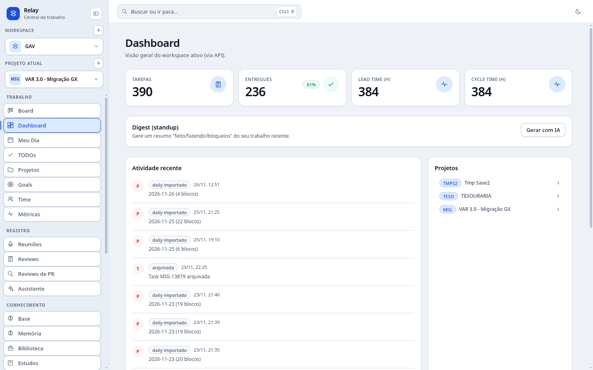
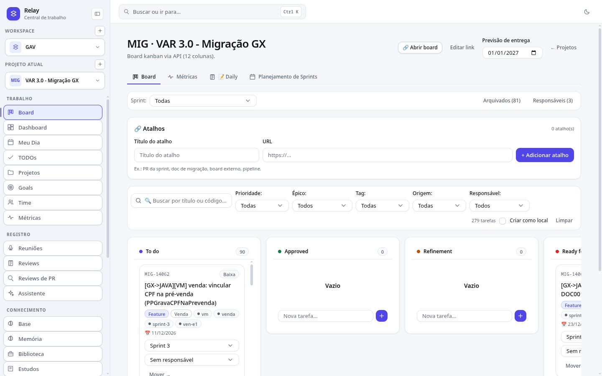
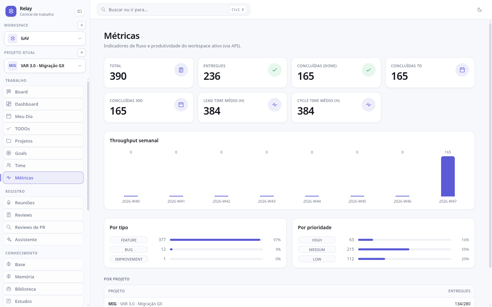
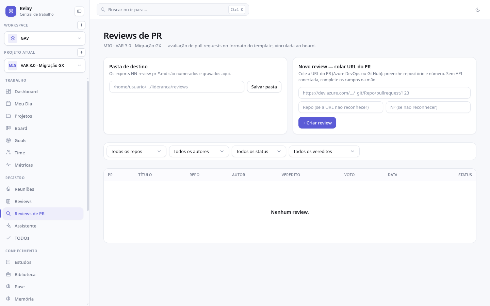
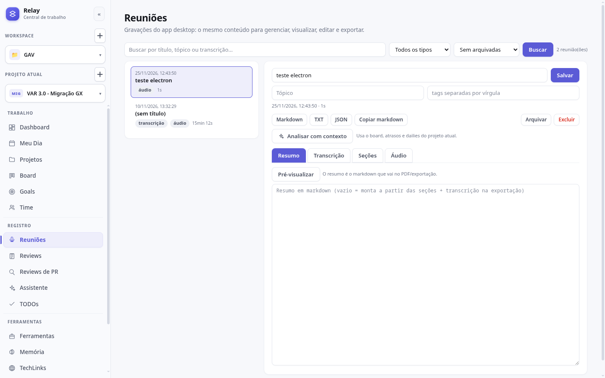
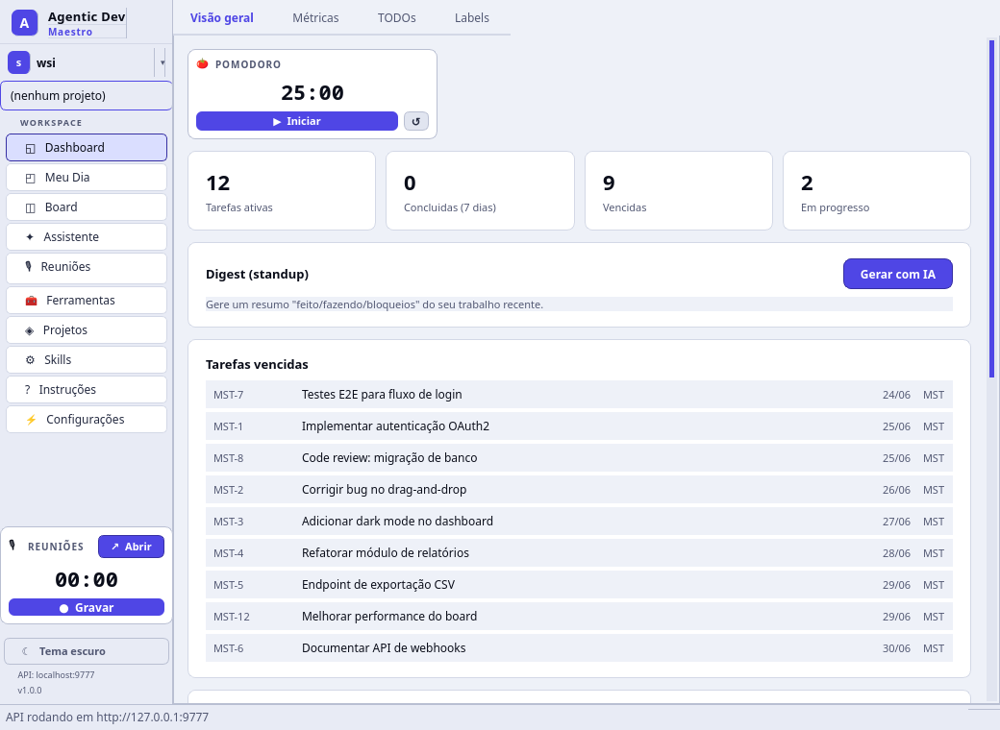
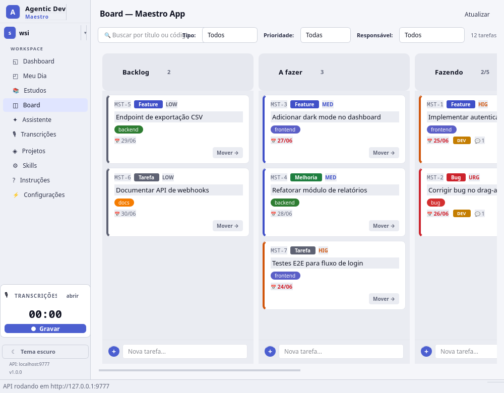
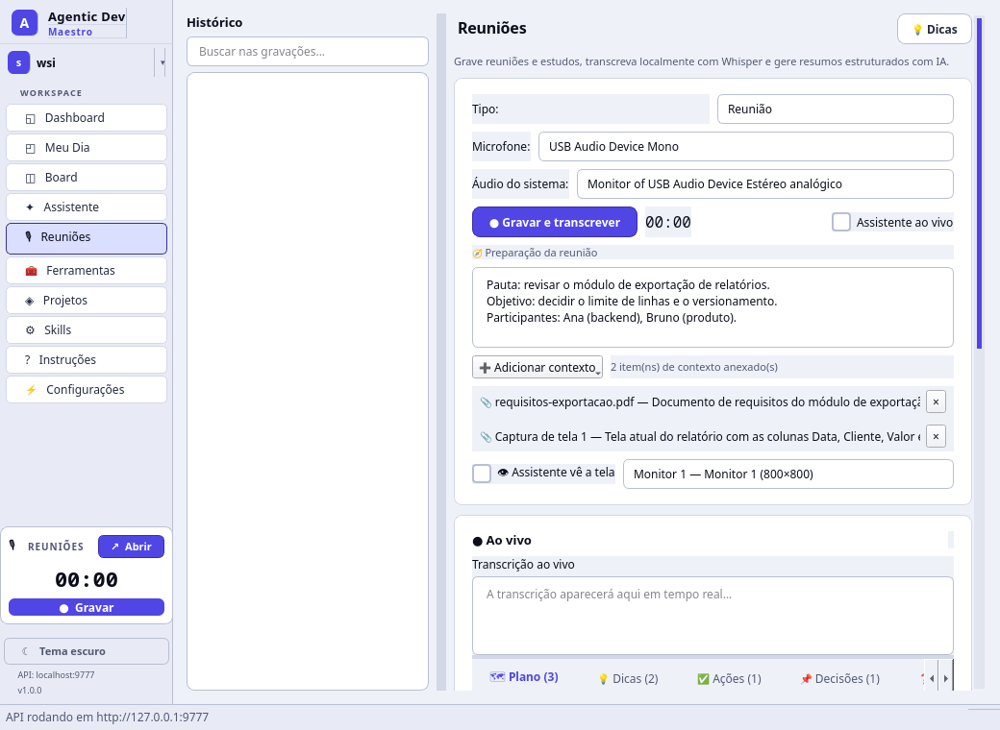

> 🇧🇷 [Portuguese version](README.md) — the Portuguese README is the default.

# Relay

Desktop application for project management, work journaling, and study tracking — an **Electron** shell around the **React** web UI (`local-client/webui`), with a **Python sidecar** (FastAPI + SQLite + AI + transcription) and an embedded REST API for integration with AI agents.

> 📷 Screenshots are from the Electron app (shell + web UI), captured on 26/11/2026 at 1440×900 — see [Screenshots](#screenshots). The old Qt GUI images remain in `local-client/docs/screenshots/` for historical reference.

## What it is

Relay is a local tool for developers who want to organize their daily work, manage tasks on a kanban board, track their studies, and integrate AI agents into their development workflow. Everything runs locally — no external server, no account, no internet dependency.

The product has two layers (see [ADR-0001](docs/adr/0001-electron-unificacao.md)):

- **Electron** (`electron/`) — thin shell: window, tray, single instance, autostart, global shortcut, notifications, screen capture, and auto-update. It does not reimplement product logic.
- **Python** (`local-client/`) — owns the API, SQLite, assistant, transcription (parec + faster-whisper), Obsidian sync, and backup. Runs as the Electron sidecar or standalone (headless).

### Key differentiators

- **Fully local**: data in SQLite, native desktop GUI, no cloud
- **Assistant**: internal AI agent (LangGraph) with a configurable provider (LM Studio, opencode) that acts on the board
- **Cronista**: records meetings/study sessions, transcribes locally with Whisper, and summarizes with AI (the former wsi-cronista project, now integrated)
- **Agent API**: AI agents create tasks, move them on the board, log code reviews, and generate reports — all via REST
- **Ready-made skills**: 17 installable skills that teach agents how to use Relay
- **Isolated workspaces**: each workspace has its own database, letting you separate personal from professional projects
- **Obsidian sync**: synchronizes daily notes and tasks with your Obsidian vault
- **Integrated Pomodoro (legacy PySide GUI)**: timer on the Dashboard for focus sessions

## How to run it today

Three paths, in order of priority:

| Path | Status | Command |
|---|---|---|
| **Electron** (shell + web UI) | primary | `cd electron && npm run dev` |
| **API + web in the browser** | primary for headless/server | `cd local-client && ./run-web.sh` |
| **PySide6 GUI** | legacy in transition | `cd local-client && ./run.sh` (or `python -m relay`) |

### 1. Electron (primary path)

```bash
# first run: creates the .venv, installs Python deps and builds the web UI
cd local-client && ./install.sh

# first run: install the shell
cd ../electron && npm install

# run
npm run dev
```

Without `ELECTRON_URL` and with no server running, `npm run dev` starts the Python sidecar itself from the dev `.venv`. To point at a server or the vite dev server already running:

```bash
ELECTRON_URL=http://127.0.0.1:9777 npm run dev
```

Variables (`RELAY_PORT`, `RELAY_PYTHON`, `RELAY_AUTOSTART`, `ELECTRON_DEV`), shortcuts and shell limits: [electron/README.md](electron/README.md).

Packaging (Linux):

```bash
cd electron
npm run pack   # dist/ folder without installer (smoke test)
npm run dist   # AppImage + .deb
```

`npm run dist` expects `local-client/dist-sidecar/relay-server`, produced by `local-client/build-sidecar.sh` (PyInstaller one-file, CPU-only). Full release/auto-update runbook: [docs/e3-packaging.md](docs/e3-packaging.md).

### 2. API + web (headless)

```bash
cd local-client
./run-web.sh                # builds the webui if missing and starts API + web
# or
python -m relay.webmain --port 9777
# or, through the classic entry point:
python -m relay --headless  # alias: --no-gui
```

API at `http://127.0.0.1:9777/api`; web UI at the root `http://127.0.0.1:9777/`.

### 3. PySide6 GUI (legacy)

```bash
cd local-client
./run.sh          # or: python -m relay
```

The Qt GUI is frozen after per-view parity (E2) and goes away after one release with a warning. The mapping of what still needs an HTTP endpoint is in [docs/e2-parity-matrix.md](docs/e2-parity-matrix.md).

### Architecture documents

- [ADR-0001 — Unification on Electron](docs/adr/0001-electron-unificacao.md)
- [E2 — PySide GUI → HTTP parity matrix](docs/e2-parity-matrix.md)
- [E3 — Packaging and release](docs/e3-packaging.md)
- [electron/README.md](electron/README.md) — variables, shortcuts, shell checklist
- [UI — rebuild plan and design system](docs/ui-rebuild-plan.md)
- [docs/prints/README.md](docs/prints/README.md) — current Electron screenshots

## Installation with an AI agent

You can ask an AI agent (Claude Code, Cursor, etc.) to install Relay end-to-end. This section has everything the agent needs: the prerequisites to install and the exact steps. A one-line prompt to kick it off:

> Read the "Installation with an AI agent" section of the README at https://github.com/WalterSilva5/relay.git, install the prerequisites for my OS, clone the repo, run `local-client/install.sh`, run `npm install` and `npm run dev` inside `electron/`, then explain how to use the app.

### Prerequisites the agent must install

Install these **system packages** first. The Python libraries are handled by `install.sh` inside a virtualenv — do **not** install them globally.

| Dependency | Why | Required |
| --- | --- | --- |
| **git** | clone the repository | yes |
| **Python 3.10+** (with the `venv` module) | sidecar: API, AI, transcription | yes |
| **Node.js 18+ and npm** | web UI build and Electron shell | yes (Electron shell) |
| **pulseaudio-utils** (`parec` / `pactl`) | system-audio capture for Meetings / Transcriptions | Linux, for meetings |

Install per OS:

```bash
# Debian / Ubuntu
sudo apt update && sudo apt install -y git python3 python3-venv python3-pip pulseaudio-utils nodejs npm

# Arch / Manjaro
sudo pacman -S --needed git python nodejs npm libpulse

# Fedora
sudo dnf install -y git python3 python3-pip nodejs npm pulseaudio-utils

# macOS (Homebrew)
brew install git python node

# Windows (winget) — native install; meeting recording needs Linux/WSL2
winget install Git.Git Python.Python.3.12 OpenJS.NodeJS
```

> **Meetings / Transcriptions** capture system audio through PulseAudio's `parec` — a **Linux** feature. Without `pulseaudio-utils` the rest of the app still runs; only recording is disabled.
>
> **AI features** (assistant, meeting copilot, image/screen context) need an OpenAI-compatible provider configured in **Settings** (e.g. LM Studio locally, or a paid endpoint). Reading images/screenshots as meeting context requires a **vision-capable** model.

### Steps

The agent should:

1. Install the prerequisites above for the user's OS.
2. Clone the repository: `git clone https://github.com/WalterSilva5/relay.git`
3. Run the installer from `local-client/`: **`./install.sh`** (Linux/macOS) or **`.\install.ps1`** (Windows/PowerShell) — creates a `.venv`, installs the Python deps (`pip install -e .`), validates, and builds the web UI when `npm` is present.
4. Install the shell: `cd electron && npm install`.
5. Run: `npm run dev` in `electron/`. Electron starts the Python sidecar from the `.venv` and opens the web UI in the window; the API serves at `http://127.0.0.1:9777/api`.
6. Open **Settings** and configure an AI provider (base URL, model, API key) to enable the assistant and the meeting copilot.
7. On the **Skills** tab, install the skills into the user's project directory — they teach the agent how to use the Relay API to create tasks, document progress, and generate reports.
8. *(Optional)* Package it: `cd electron && npm run dist` (AppImage + .deb) — see [docs/e3-packaging.md](docs/e3-packaging.md).

## Features

### My Day (home)
Main screen with daily notes in markdown, a pre-configured template, automatic report generation with an activity summary, and synchronization with an Obsidian vault. Date picker with a popup calendar for navigating between days. Includes a prompt hint so AI agents can generate the summary via a skill.

### Dashboard
Overview of the active workspace: KPIs (tasks, delivered, lead time, and cycle time), AI standup digest, recent activity, and projects with quick access to the board. Data comes from the API (`/api/projects/metrics`, `/api/activity`, `/api/projects`).

> The legacy PySide GUI keeps a tabbed Dashboard with Pomodoro, Metrics, TODOs, and Labels; the primary Electron/web UI uses the separate routes in the menu.

### Kanban Board
Board with drag-and-drop, columns customizable per project, filters by type/priority/assignee, a quick-move button to advance tasks, WIP limits, and a mandatory code review indicator. Agents always create review tasks (`requiresHuman: true`) so the developer can validate changes.

### Reviews
- **PR review** (`/reviews-pr`): builds the review document from the PR diff (`merge-base`, conflict via `merge-tree`) with a verdict and checks (card scope, tests, parity/contract, multi-tenant, long IDs). Exports `.md` and sends it to the configured destination.
- **Weekly review** (`/reviews`): per-person assessment in the vault format (technical/behavioural competencies, comment, evidence), with week-over-week comparison.
- API: `/api/projects/{id}/pr-reviews` (+ `/diff`, `/export.md`, `/send`, `/reopen`) and `/api/projects/{id}/reviews` (+ `/export.md`, `/send`, `/reopen`).

### Assistant
Internal AI assistant that runs with your own provider (local LM Studio, opencode, or any OpenAI-compatible API). It reads the board, suggests priorities, requests task reviews, creates TODOs, and comments on tasks — all within the application. Built with LangGraph and internal tools. Configurable under Settings → AI Providers.

**Proactive coach:** throughout the day the agent surfaces short, actionable tips based on your board and TODOs (focus, organization, risk, or a healthy break) in a non-intrusive card (desktop **and** web UI). It also reacts to real signals — stuck tasks (idle 3+ days), high WIP, overdue TODOs — nudging on the spot (with a cooldown) instead of only on a timer. Opt-in and configurable under Settings → Proactive coach (interval); also available via `GET /api/coach/tip`.

### Transcriptions (Meetings)
Records meetings and study sessions (microphone and/or system audio via PipeWire/PulseAudio), transcribes locally with faster-whisper, and generates structured summaries with AI — meetings become key points/decisions/action items; study sessions become concepts/exercises/related topics.

The screen follows an explicit flow: **📁 Destination → 1 Prepare → 2 Record → 3 Result**.

- **📁 Destination** — the target workspace and project sit at the top: that's where the meeting and generated tasks go. Switching workspace asks for confirmation.
- **1 Prepare** — agenda/goals plus attached context (files, PDFs, images, or a screenshot; images/screens are read by a vision model), so the copilot starts already knowing what it's about.
- **2 Record** — audio sources live in a collapsible block (the Record button stays prominent). With the **live copilot**, plan, tips, actions, decisions and Q&A appear in real time, plus an "ask the meeting" box.
- **3 Result** — transcript + summary and a grouped action bar: `↻ Analyze with AI │ Document: Export/Copy │ Send to: Create tasks/My Day`. The summary toggles between **Markdown source and formatted preview**.
- **Automatic analysis** — when transcription finishes the report is generated on its own (with an AI provider configured); no need to click "Analyze".
- **Editable transcript** — fix the text at any time and the agent **reviews the items** automatically.
- **Manual answers** — answer the agent's questions right on the cards; it treats those answers as confirmed information and won't discard them when reprocessing.
- **Everything saved automatically** — plan/tips/actions/decisions/questions are stored with the meeting; reopening restores it exactly as it was.
- **Watch a monitor** — let the assistant periodically see a chosen screen to help solve on-screen tasks; toggleable during the meeting.
- **Import from external transcripts** — create a meeting from a Meet/Teams export (text, VTT/SRT, PDF, DOCX) and run the same analysis.
- **History** — searchable; **➕ New meeting** (starts from scratch), delete, archive and reorder; meetings are named with a date/time prefix.
- Global **Ctrl+Shift+R** shortcut.

Features migrated from the wsi-cronista project.

### Projects
Create and manage projects with a unique key (e.g., DEMO). Each project has its own board columns, tasks, labels, and metrics.

### Labels
Create labels with colors from the palette and apply them to tasks to categorize and filter. Labels are shared across projects in the same workspace.

### Metrics
Dashboard with total tasks, completed (7 and 30 days), average lead time, cycle time, weekly throughput with a bar chart, and a breakdown by type, priority, and project.

### Studies
Study plans with a visual roadmap, categories (Language, Framework, Certification, Concept, Course, Book), weighted topics, and sessions with hour tracking and a confidence level (1-5).

### Knowledge base
Notes/wiki (reuses `Document` type=KB) with `[[title]]` backlinks and AI Q&A over your notes (RAG-lite: keyword retrieval + cited answer). API `/api/kb/notes`, `/api/kb/ask`; screen `/base`.

### Skills
Library of 17 skills for AI agents. Each skill is a SKILL.md file that can be installed into the project's `.claude/skills/` directory. "Install all" button for quick setup.

### Instructions
Application usage guide with 12 sections, including explanations of each screen, the workflow, the role of agents, and review tasks.

### Settings
General settings screen with:
- **AI Providers**: register/select OpenAI-compatible providers (LM Studio, Ollama, OpenAI, OpenRouter, Groq, DeepSeek, Mistral, Gemini, Together, opencode), with a connection test. Used by the Assistant
- **Pomodoro**: configurable session duration (1-120 min)
- **Push notifications**: periodic desktop notifications with a custom message, configurable interval, and enable/disable toggle

### General features
- Dark/light theme with a toggle in the sidebar
- Configurable Pomodoro timer on the Dashboard (PySide)
- Quick access to Transcriptions in the sidebar (record in 1 click)
- Periodic push notifications with a custom message
- Global task search (Ctrl+K)
- Isolated workspaces with separate databases, customizable emojis and colors
- Database backup
- Auto-sync with an Obsidian vault per workspace (every 5 min)
- Vault configurable per workspace and project

## Quick Start (automated install)

Both scripts do the same thing: find Python 3.10+, create the `.venv`, install the
dependencies, validate the install, and build the web UI when `npm` is available.

**Linux / macOS**

```bash
cd local-client
./install.sh    # creates venv + installs dependencies + validates + builds the webui
./run.sh        # Qt GUI (legacy)
./run-web.sh    # API + web (headless)
```

**Windows (PowerShell)**

```powershell
cd local-client
.\install.ps1   # creates venv + installs dependencies + validates
.\run.ps1       # runs the application (optional: --port 8888)
```

> If PowerShell blocks the script, run it as:
> `powershell -ExecutionPolicy Bypass -File .\install.ps1`
>
> **Windows note:** meeting *recording* uses PulseAudio's `parec` and is Linux-only.
> Everything else works on Windows (board, AI assistant, importing Meet/Teams
> transcripts, web UI); only live audio capture is unavailable.

Or manually:

```bash
cd local-client
python3 -m venv .venv
source .venv/bin/activate      # Windows: .venv\Scripts\activate
pip install -e .
python -m relay.webmain        # API + web
# or: python -m relay          # Qt GUI (legacy)
```

The application opens with:
- **Electron window** (primary) — web UI + Python sidecar; see [How to run it today](#how-to-run-it-today)
- **Qt desktop GUI** (legacy) — 10 screens in the menu (Metrics, TODOs, and Labels became Dashboard tabs)
- **REST API** — `http://127.0.0.1:9777/api` for AI agents

### Custom port

```bash
./run.sh --port 8888              # Qt GUI (legacy)
python -m relay.webmain --port 8888
RELAY_PORT=8888 npm run dev       # Electron (inside electron/)
```

### Desktop shell (Electron — primary)

The desktop shell is Electron with the React web UI (`local-client/webui`), backed
by the Python sidecar. See [ADR-0001](docs/adr/0001-electron-unificacao.md) and
[electron/README.md](electron/README.md).

```bash
cd local-client && ./install.sh   # venv + deps + webui build
cd ../electron && npm install
npm run dev                       # starts the sidecar if none is running
```

## REST API for agents

The API runs at `http://127.0.0.1:9777/api` without authentication. Main endpoints:

| Resource | Endpoints |
|---|---|
| Health | `GET /api/health` |
| Projects | `POST/GET /api/projects`, `GET /api/projects/metrics` |
| Tasks | `POST/GET /api/tasks`, `GET/PATCH/DELETE /api/tasks/{code}`, `POST /api/tasks/{code}/move` |
| Checklist | `POST /api/tasks/{code}/checklist`, `PATCH/DELETE /api/tasks/checklist/{id}` |
| Labels | `POST/GET /api/labels`, `POST/DELETE /api/labels/{id}/tasks/{task_id}` |
| Comments | `GET/POST /api/comments`, `PATCH/DELETE /api/comments/{id}` |
| Journal | `GET/POST /api/daily/{date}`, `PATCH /api/daily/{date}/report` |
| TODOs | `GET/POST /api/todos`, `PATCH/DELETE /api/todos/{id}` |
| Studies | `POST/GET /api/study/plans`, `PATCH/DELETE /api/study/plans/{id}` |
| Reviews | `POST/GET /api/projects/{id}/reviews`, `POST/GET /api/projects/{id}/pr-reviews` |
| History | `GET /api/tasks/{code}/history` |
| Changelog | `GET /api/projects/{project_id}/changelog?days=7` |
| Activity | `GET /api/activity` |

## Skills for AI agents

| Skill | What it does |
|---|---|
| `relay-use` | Orchestrator: analyses the moment and picks which skills to use |
| `relay-run` | Start the application (GUI + API) |
| `relay-api-agent` | Teaches the agent to use the REST API |
| `relay-task-workflow` | Complete workflow: pick a task, implement, move, document |
| `relay-project-setup` | Create a project with default columns and labels |
| `relay-sprint-planning` | Plan a sprint with estimates and prioritization |
| `relay-code-review-log` | Log code reviews as comments |
| `relay-bug-triage` | Bug triage with priority and reproduction |
| `relay-daily-standup` | Generate an automatic standup report |
| `relay-tech-debt-tracker` | Log and prioritize technical debt |
| `relay-documentation-writer` | Generate documentation from code |
| `relay-daily-report` | Daily report with notes, activity, and summary (supports partial mode) |
| `relay-context-loader` | Load the full workspace context to resume work from where you left off |
| `relay-agentic-memory` | Workspace agentic memory: search, write, ingest, and query decisions |
| `relay-project-daily` | Read, filter, create, and edit the project daily log |
| `relay-goals` | Track goals with progress and countdown |
| `relay-members` | Manage assignees, assign cards, and view per-person metrics |

## Screenshots

Real Electron app screenshots (shell + web UI), 1440×900, light theme, MIG project, captured on **26/11/2026** — design system v2, Board first in the menu, bordered items, indigo/slate palette:







Legacy Qt GUI screenshots remain in `local-client/docs/screenshots/`

<details>
<summary>Old captures (Qt GUI, legacy)</summary>





</details>

## Project structure

```
relay/
├── electron/                  # Desktop shell (Electron): window, tray, hotkey, update
│   ├── main.js                # main process + sidecar lifecycle
│   ├── preload.js
│   ├── assets/                # icon
│   └── README.md
│
├── local-client/              # Python product (FastAPI + SQLite + AI + audio)
│   ├── relay/                 # Source code
│   │   ├── api/               # FastAPI endpoints
│   │   ├── db/                # SQLAlchemy + SQLite
│   │   ├── ai/                # Assistant (LangGraph)
│   │   ├── transcricoes/      # Recording + Whisper
│   │   ├── gui/               # PySide6 GUI (legacy; freezes after E2)
│   │   └── skills/            # Skill catalog
│   ├── webui/                 # React + Vite web UI (official UI in Electron)
│   ├── install.sh             # Install (venv + deps + webui)
│   ├── run.sh                 # Qt GUI (legacy)
│   ├── run-web.sh             # API + web (headless)
│   ├── build-sidecar.sh       # PyInstaller one-file (E3)
│   ├── pyproject.toml         # Python dependencies
│   └── docs/screenshots/      # Old screenshots (Qt GUI)
│
├── web-client/                # Web client (NestJS + Angular) — FROZEN (ADR-0001)
├── mcp/                       # MCP server for integration
├── docs/
│   ├── adr/0001-electron-unificacao.md
│   ├── e2-parity-matrix.md
│   ├── e3-packaging.md
│   └── prints/                # Current Electron screenshots
├── CLAUDE.md                  # Guide for AI agents
└── README.md
```

## Data

Data lives in `~/.relay/`:

```
~/.relay/
├── config.json                # Settings (workspaces, vault paths, theme)
└── workspaces/
    ├── default/
    │   └── maestro.db         # SQLite database for the default workspace
    └── {workspace-id}/
        └── maestro.db         # SQLite database for each workspace
```

## Requirements

- Python 3.10+ (with the `venv` module)
- Node.js 18+ and npm — web UI build and Electron shell
- git
- Operating system: Linux, macOS, or Windows (Windows via WSL2)
- Qt 6 (installed automatically with PySide6) — only needed for the legacy GUI
- `pulseaudio-utils` (`parec` / `pactl`) — Linux only, for Meetings/Transcriptions recording
- An OpenAI-compatible AI provider — optional, to enable the assistant and meeting copilot (a vision-capable model is needed to read images/screens as context)
- Packaged app: **Linux** (X11 + Wayland) at this stage; Windows later (ADR-0001)

See [Installation with an AI agent](#installation-with-an-ai-agent) for the per-OS install commands.

## License

Private License. Copyright (c) 2026 WalterSilva5. All rights reserved. See the [LICENSE](LICENSE) file for details.
