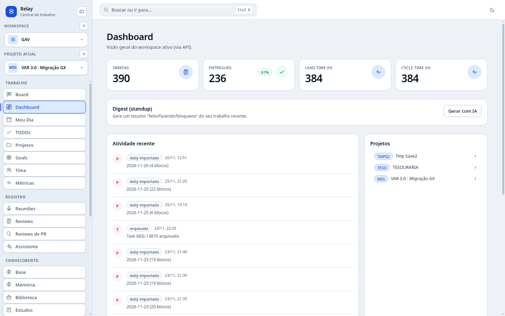
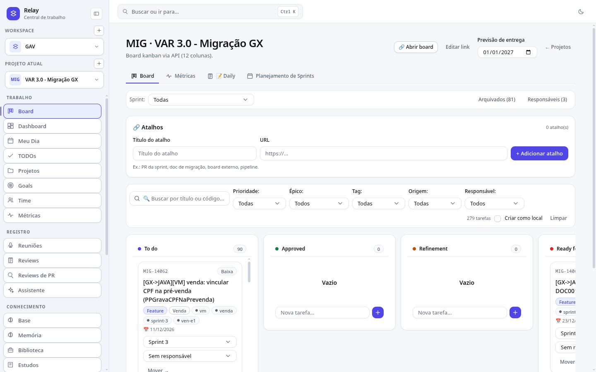
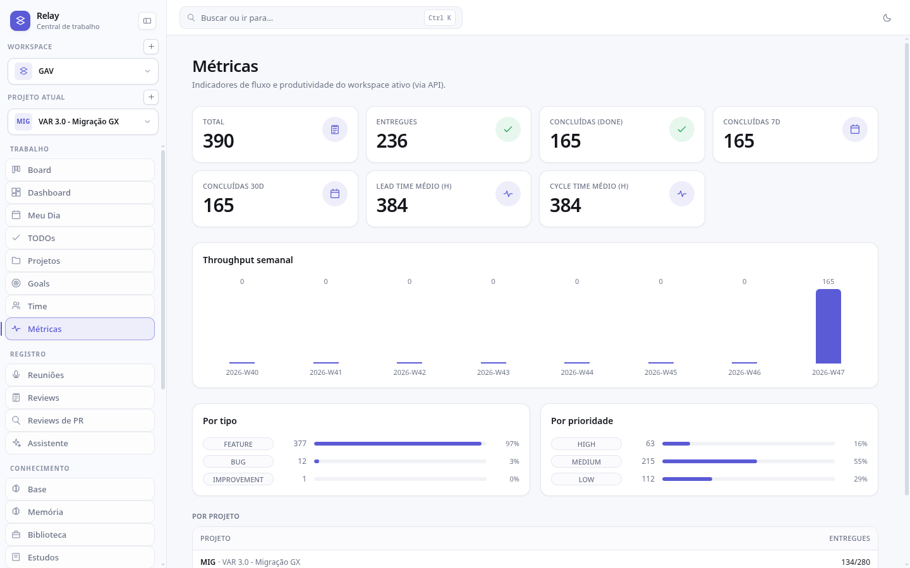
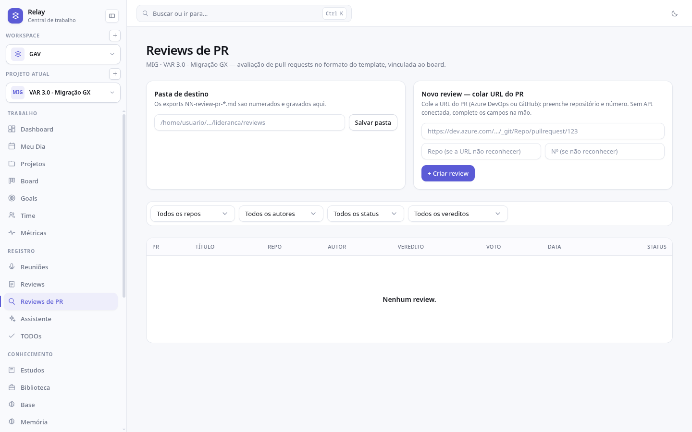
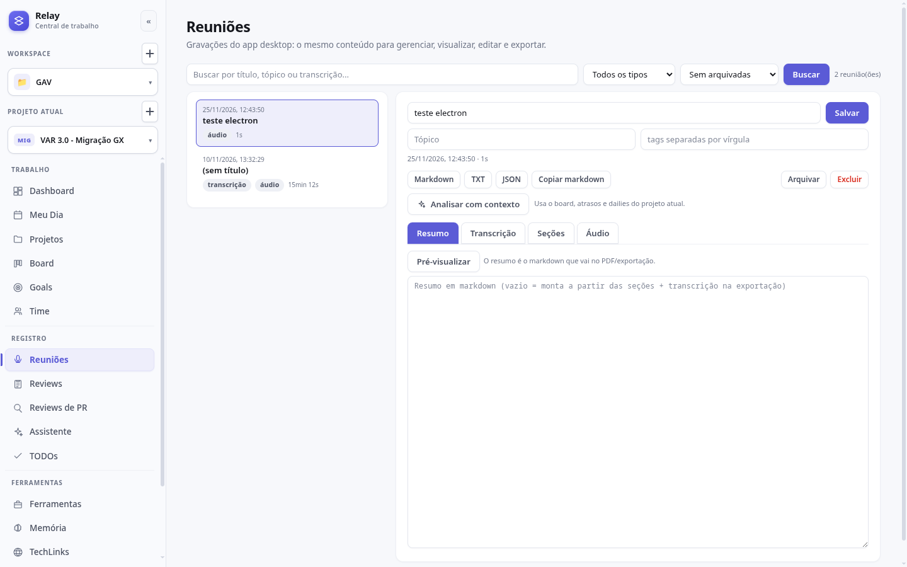
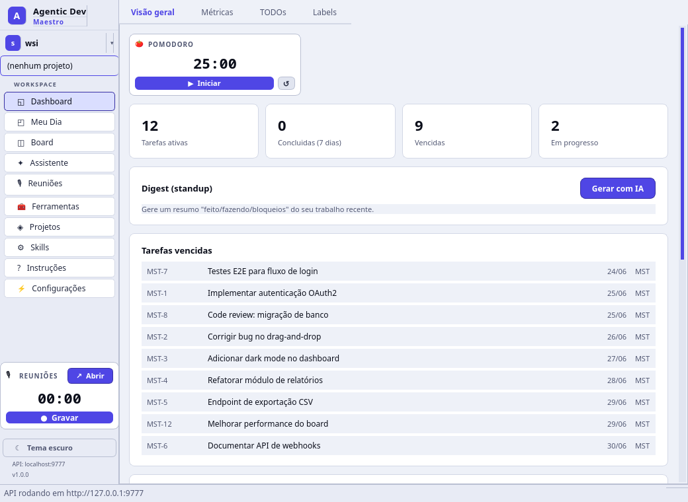
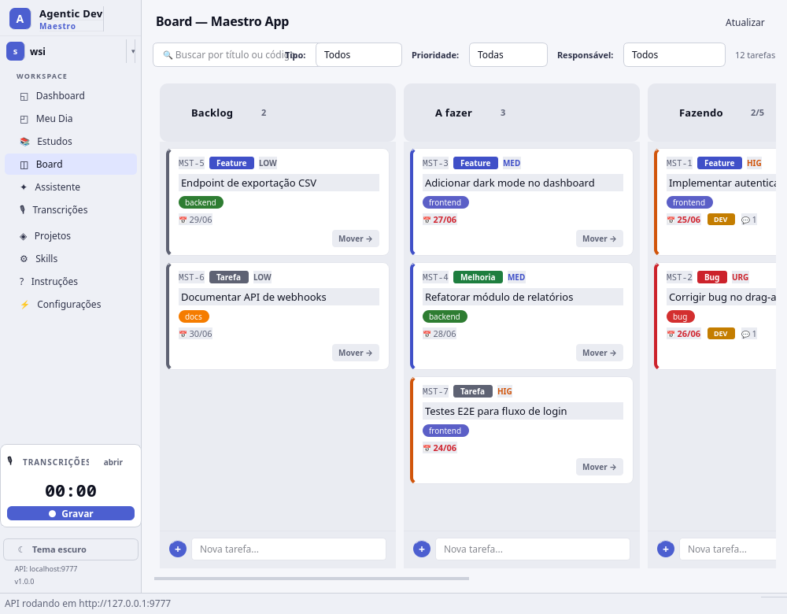
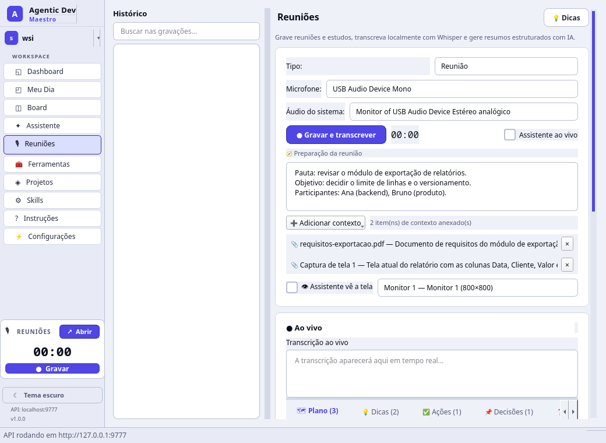

> 🇬🇧 [English version](README.en.md)

# Relay

Aplicação desktop para gestão de projetos, diário de trabalho e estudos — shell **Electron** com a web UI **React** (`local-client/webui`) e um **sidecar Python** (FastAPI + SQLite + IA + transcrição) — com API REST embutida para integração com agentes de IA.

> 🖼️ As capturas de tela são do app Electron (shell + web UI), em 1440×900 — ver [Capturas de tela](#capturas-de-tela).

## O que é

O Relay é uma ferramenta local para desenvolvedores que querem organizar seu trabalho diário, gerenciar tarefas em kanban, acompanhar estudos e integrar agentes de IA no fluxo de desenvolvimento. Tudo roda localmente — sem servidor externo, sem conta, sem dependência de internet.

O produto tem duas camadas (ver [ADR-0001](docs/adr/0001-electron-unificacao.md)):

- **Electron** (`electron/`) — shell fino: janela, tray, instância única, autostart, atalho global, notificações, captura de tela e auto-update. Não reimplementa produto.
- **Python** (`local-client/`) — dono da API, do SQLite, do assistente, da transcrição (parec + faster-whisper), do sync Obsidian e do backup. Roda como sidecar do Electron ou sozinho (headless).

### Principais diferenciais

- **Tudo local**: dados em SQLite, GUI desktop, sem cloud
- **Assistente**: agente de IA interno (LangGraph) com provedor configurável (LM Studio, opencode) que age sobre o board
- **Cronista**: grava reuniões/estudos, transcreve local com Whisper e resume com IA (ex-projeto wsi-cronista integrado)
- **API para agentes**: agentes de IA criam tarefas, movem no board, registram code reviews e geram relatórios — tudo via REST
- **Skills prontas**: 17 skills instaláveis que ensinam agentes a usar o Relay
- **Workspaces isolados**: cada workspace tem seu próprio banco, permitindo separar projetos pessoais de profissionais
- **Obsidian sync**: sincroniza notas diárias e tarefas com seu vault do Obsidian
- **Pomodoro integrado (GUI PySide legada)**: timer no Dashboard para sessões de foco

## Como rodar hoje

Três caminhos, em ordem de prioridade:

| Caminho | Status | Comando |
|---|---|---|
| **Electron** (shell + web UI) | principal | `cd electron && npm run dev` |
| **API + web no navegador** | principal para headless/servidor | `cd local-client && ./run-web.sh` |
| **GUI PySide6** | legado em transição | `cd local-client && ./run.sh` (ou `python -m relay`) |

### 1. Electron (caminho principal)

```bash
# 1ª vez: cria o .venv, instala as deps Python e builda a web UI
cd local-client && ./install.sh

# 1ª vez: instala o shell
cd ../electron && npm install

# rodar
npm run dev
```

Sem `ELECTRON_URL` e sem servidor rodando, o `npm run dev` sobe o sidecar Python sozinho a partir do `.venv` de dev. Para apontar a um servidor ou ao vite já rodando:

```bash
ELECTRON_URL=http://127.0.0.1:9777 npm run dev
```

Variáveis (`RELAY_PORT`, `RELAY_PYTHON`, `RELAY_AUTOSTART`, `ELECTRON_DEV`), atalhos e limites do shell: [electron/README.md](electron/README.md).

Empacotamento (Linux):

```bash
cd electron
npm run pack   # pasta dist/ sem instalador (fumaça)
npm run dist   # AppImage + .deb
```

O `npm run dist` espera `local-client/dist-sidecar/relay-server`, gerado por `local-client/build-sidecar.sh` (PyInstaller one-file, CPU-only). Runbook completo de release e auto-update: [docs/e3-packaging.md](docs/e3-packaging.md).

### 2. API + web (headless)

```bash
cd local-client
./run-web.sh                # builda a webui se faltar e sobe API + web
# ou
python -m relay.webmain --port 9777
# ou, pelo entry point clássico:
python -m relay --headless  # alias: --no-gui
```

API em `http://127.0.0.1:9777/api`; web UI na raiz `http://127.0.0.1:9777/`.

### 3. GUI PySide6 (legado)

```bash
cd local-client
./run.sh          # ou: python -m relay
```

A GUI Qt está congelada após a paridade por view (E2) e sai depois de um release com aviso. O mapeamento do que falta migrar para HTTP está em [docs/e2-parity-matrix.md](docs/e2-parity-matrix.md).

### Documentos de arquitetura

- [ADR-0001 — Unificação no Electron](docs/adr/0001-electron-unificacao.md)
- [E2 — Matriz de paridade GUI PySide → HTTP](docs/e2-parity-matrix.md)
- [E3 — Empacotamento e release](docs/e3-packaging.md)
- [electron/README.md](electron/README.md) — variáveis, atalhos, checklist do shell
- [UI — plano de reconstrução e design system](docs/ui-rebuild-plan.md)
- [UI — guia de migração das páginas](docs/ui-migration-guide.md)
- [docs/prints/](docs/prints/) — capturas de tela atuais (Electron)

## Instalação com agente de IA

Você pode pedir a um agente de IA (Claude Code, Cursor, etc.) para instalar o Relay de ponta a ponta. Esta seção tem tudo que o agente precisa: os pré-requisitos a instalar e os passos exatos. Um prompt de uma linha para começar:

> Leia a seção "Instalação com agente de IA" do README em https://github.com/WalterSilva5/relay.git, instale os pré-requisitos para o meu SO, clone o repositório, execute o `local-client/install.sh`, rode `npm install` e `npm run dev` dentro de `electron/`, e me explique como usar a aplicação.

### Pré-requisitos que o agente deve instalar

Instale estes **pacotes de sistema** primeiro. As bibliotecas Python são tratadas pelo `install.sh` dentro de um virtualenv — **não** as instale globalmente.

| Dependência | Para quê | Obrigatório |
| --- | --- | --- |
| **git** | clonar o repositório | sim |
| **Python 3.10+** (com o módulo `venv`) | sidecar: API, IA, transcrição | sim |
| **Node.js 18+ e npm** | build da web UI e shell Electron | sim (shell Electron) |
| **pulseaudio-utils** (`parec` / `pactl`) | captura do áudio do sistema em Reuniões / Transcrições | Linux, para reuniões |

Instalação por SO:

```bash
# Debian / Ubuntu
sudo apt update && sudo apt install -y git python3 python3-venv python3-pip pulseaudio-utils nodejs npm

# Arch / Manjaro
sudo pacman -S --needed git python nodejs npm libpulse

# Fedora
sudo dnf install -y git python3 python3-pip nodejs npm pulseaudio-utils

# macOS (Homebrew)
brew install git python node

# Windows (winget) — instalação nativa; gravar reuniões exige Linux/WSL2
winget install Git.Git Python.Python.3.12 OpenJS.NodeJS
```

> **Reuniões / Transcrições** capturam o áudio do sistema via `parec` do PulseAudio — recurso **Linux**. Sem o `pulseaudio-utils` o resto da aplicação continua funcionando; só a gravação fica desabilitada.
>
> **Recursos de IA** (assistente, copiloto de reunião, contexto por imagem/tela) precisam de um provedor compatível com OpenAI configurado em **Configurações** (ex.: LM Studio local ou um endpoint pago). Ler imagens/capturas de tela como contexto exige um modelo **com visão**.

### Passos

O agente deve:

1. Instalar os pré-requisitos acima para o SO do usuário.
2. Clonar o repositório: `git clone https://github.com/WalterSilva5/relay.git`
3. Rodar o instalador dentro de `local-client/`: **`./install.sh`** (Linux/macOS) ou **`.\install.ps1`** (Windows/PowerShell) — cria um `.venv`, instala as dependências Python (`pip install -e .`), valida e builda a web UI quando o `npm` está presente.
4. Instalar o shell: `cd electron && npm install`.
5. Rodar: `npm run dev` em `electron/`. O Electron sobe o sidecar Python do `.venv` e abre a web UI na janela; a API fica em `http://127.0.0.1:9777/api`.
6. Abrir **Configurações** e configurar um provedor de IA (base URL, modelo, API key) para habilitar o assistente e o copiloto de reunião.
7. Na aba **Skills**, instalar as skills no diretório do projeto do usuário — elas ensinam o agente a usar a API do Relay para criar tarefas, documentar progresso e gerar relatórios.
8. *(Opcional)* Empacotar: `cd electron && npm run dist` (AppImage + .deb) — ver [docs/e3-packaging.md](docs/e3-packaging.md).

## Funcionalidades

### Meu Dia (home)
Tela principal com notas diárias em markdown, template pre-configurado, geração de relatório automático com resumo de atividades, e sincronização com Obsidian vault. Date picker com calendário popup para navegar entre dias. Inclui dica de prompt para que agentes de IA gerem o resumo via skill.

### Dashboard
Visão geral do workspace ativo: KPIs (tarefas, entregues, lead time e cycle time), digest do standup gerado por IA, atividade recente e projetos com acesso rápido ao board. Dados vêm da API (`/api/projects/metrics`, `/api/activity`, `/api/projects`).

> A GUI PySide legada mantém um Dashboard em abas com Pomodoro, Métricas, TODOs e Labels; a UI principal (Electron/web) usa as rotas separadas do menu.

### Board Kanban
Board horizontal com colunas customizáveis por projeto, filtros por prioridade/épico/tag/origem/responsável, seletor de sprint, WIP limits, quick-add e botão **Mover →** para avançar tarefas. Colunas grandes mostram um lote inicial de cards e liberam o restante em **Mostrar mais** (evita montar centenas de selects de uma vez). Clicar no card abre o detalhe com descrição, checklist, comentários e dependências. Agentes sempre criam tarefas de revisão (`requiresHuman: true`) para o desenvolvedor validar alterações.

> O drag-and-drop entre colunas existe na GUI PySide legada; na web/Electron o movimento é pelo botão **Mover →**.

### Reviews
- **Review de PR** (`/reviews-pr`): monta o documento de review a partir do diff do PR (base `merge-base`, conflito via `merge-tree`) com veredito e checagens (escopo do card, testes, paridade/contrato, multi-tenant, IDs longos). Exporta `.md` e envia para o destino configurado.
- **Review semanal** (`/reviews`): avaliação por pessoa no formato do vault (competências técnicas/comportamentais, comentário e evidências), com comparação entre semanas.
- API: `/api/projects/{id}/pr-reviews` (+ `/diff`, `/export.md`, `/send`, `/reopen`) e `/api/projects/{id}/reviews` (+ `/export.md`, `/send`, `/reopen`).

### Assistente
Assistente de IA interno que roda com seu próprio provedor (LM Studio local, opencode ou qualquer API compatível com OpenAI). Ele lê o board, sugere prioridades, solicita revisões de tarefas, cria TODOs e comenta tarefas — tudo dentro da aplicação. Construído com LangGraph e ferramentas internas. Configurável em Configurações → Provedores de IA.

**Coach proativo:** ao longo do dia o agente exibe dicas curtas e acionáveis com base no seu board e TODOs (foco, organização, risco ou uma pausa saudável) num card não intrusivo (desktop **e** web UI). Ele também reage a sinais reais — tarefas paradas (3+ dias sem alteração), WIP alto, TODOs vencidos — cutucando na hora (com cooldown) em vez de só por tempo. Opt-in e configurável em Configurações → Coach proativo (intervalo); também disponível via `GET /api/coach/tip`.

### Transcrições (Reuniões)
Grava reuniões e sessões de estudo (microfone e/ou áudio do sistema via PipeWire/PulseAudio), transcreve localmente com faster-whisper e gera resumos estruturados com IA — reuniões viram pontos-chave/decisões/ações; estudos viram conceitos/exercícios/tópicos relacionados.

A tela segue um fluxo explícito: **📁 Destino → 1 Preparar → 2 Gravar → 3 Resultado**.

- **📁 Destino** — workspace e projeto de destino ficam no topo: é para lá que a reunião e as tarefas geradas vão. Trocar de workspace pede confirmação.
- **1 Preparar** — pauta/objetivos e contexto anexado (arquivos, PDFs, imagens ou uma captura de tela; imagens/telas são lidas por um modelo com visão), para o copiloto já iniciar sabendo do que se trata.
- **2 Gravar** — fontes de áudio num bloco recolhível (o botão Gravar fica em destaque). Com o **copiloto ao vivo**, plano, dicas, ações, decisões e perguntas & respostas aparecem em tempo real, além do campo "perguntar à reunião".
- **3 Resultado** — transcrição + resumo e uma barra de ações agrupada: `↻ Analisar com IA │ Documento: Exportar/Copiar │ Enviar para: Criar tarefas/Meu Dia`. O resumo alterna entre **código Markdown e visualização formatada**.
- **Análise automática** — ao terminar a transcrição o relatório é gerado sozinho (havendo provedor de IA); não é preciso clicar em "Analisar".
- **Transcrição editável** — corrija o texto a qualquer momento e o agente **revisa os itens** automaticamente.
- **Respostas manuais** — responda as perguntas do agente nos próprios cards; ele trata as respostas como informação confirmada e não as descarta ao reprocessar.
- **Tudo salvo automaticamente** — plano/dicas/ações/decisões/perguntas ficam gravados com a reunião; ao reabrir, ela volta exatamente como estava.
- **Ver um monitor** — deixe o assistente ver periodicamente uma tela escolhida para ajudar a resolver tarefas na tela; ativável/desativável durante a reunião.
- **Importar de transcrições externas** — crie uma reunião a partir de uma exportação do Meet/Teams (texto, VTT/SRT, PDF, DOCX) e rode a mesma análise.
- **Histórico** — pesquisável; **➕ Nova reunião** (começa do zero), excluir, arquivar e reordenar; reuniões nomeadas com prefixo de data/hora.
- Atalho global **Ctrl+Shift+R**.

Funcionalidades migradas do projeto wsi-cronista.

### Projetos
Criar e gerenciar projetos com chave única (ex: DEMO). Cada projeto tem suas colunas de board, tarefas, labels e métricas próprias.

### Labels
Criar labels com cores da paleta, aplicar em tarefas para categorizar e filtrar. Labels são compartilhadas entre projetos do mesmo workspace.

### Métricas
Dashboard com total de tarefas, concluídas (7 e 30 dias), lead time médio, cycle time, throughput semanal com gráfico de barras, e breakdown por tipo, prioridade e projeto.

### Estudos
Planos de estudo com roadmap visual, categorias (Linguagem, Framework, Certificação, Conceito, Curso, Livro), tópicos ponderados, sessões com tracking de horas e nível de confiança (1-5).

### Base de conhecimento
Notas/wiki (reusa `Document` type=KB) com backlinks `[[título]]` e Q&A da IA sobre as notas (RAG-lite: recuperação por palavras-chave + resposta com citações). API `/api/kb/notes`, `/api/kb/ask`; tela `/base`.

### Skills
Catálogo de 17 skills para agentes de IA. Cada skill é um arquivo SKILL.md; na web/Electron você visualiza, copia ou baixa o conteúdo, e a instalação em `.claude/skills/` é feita pela GUI PySide legada (botão "Instalar todas") ou manualmente.

### Instruções
Guia de uso da aplicação com 12 seções, incluindo explicações de cada tela, fluxo de trabalho, o papel dos agentes e tarefas de revisão.

### Configurações
Tela de configurações gerais com:
- **Provedores de IA**: cadastrar/selecionar provedores compatíveis com OpenAI (LM Studio, Ollama, OpenAI, OpenRouter, Groq, DeepSeek, Mistral, Gemini, Together, opencode), com teste de conexão. Usado pelo Assistente
- **Pomodoro (PySide)**: duração da sessão configurável (1-120 min)
- **Notificações push (PySide)**: notificações periódicas na área de trabalho com mensagem personalizada, intervalo configurável e ativação/desativação

### Recursos gerais
- Tema dark/light com toggle na sidebar
- Pomodoro timer configurável no Dashboard (PySide)
- Acesso rápido às Transcrições na sidebar (gravar em 1 clique) — PySide
- Notificações push periódicas com mensagem customizada
- Busca global de tarefas (Ctrl+K)
- Workspaces isolados com bancos separados, emojis e cores customizáveis
- Backup do banco de dados
- Auto-sync com Obsidian vault por workspace (a cada 5 min)
- Vault configurável por workspace e projeto

## Início Rápido (instalação automatizada)

Os dois scripts do `local-client` fazem o mesmo: encontram o Python 3.10+, criam a `.venv`, instalam as dependências, validam a instalação e buildam a web UI quando há `npm`.

**Linux / macOS**

```bash
cd local-client
./install.sh    # cria venv + instala dependências + valida + builda a webui
./run.sh        # GUI Qt (legado)
./run-web.sh    # API + web (headless)
```

**Windows (PowerShell)**

```powershell
cd local-client
.\install.ps1   # cria venv + instala dependências + valida
.\run.ps1       # executa a aplicação (opcional: --port 8888)
```

> Se o PowerShell bloquear o script, rode:
> `powershell -ExecutionPolicy Bypass -File .\install.ps1`
>
> **Nota Windows:** a *gravação* de reuniões usa o `parec` do PulseAudio e é
> exclusiva do Linux. O resto funciona no Windows (board, assistente de IA,
> importar transcrições do Meet/Teams, web UI); só a captura de áudio ao vivo
> fica indisponível.

Ou manualmente:

```bash
cd local-client
python3 -m venv .venv
source .venv/bin/activate      # Windows: .venv\Scripts\activate
pip install -e .
python -m relay.webmain        # API + web
# ou: python -m relay          # GUI Qt (legado)
```

### Porta customizada

```bash
./run.sh --port 8888              # GUI Qt (legado)
python -m relay.webmain --port 8888
RELAY_PORT=8888 npm run dev       # Electron (em electron/)
```

## API REST para agentes

A API roda em `http://127.0.0.1:9777/api` sem autenticação. Endpoints principais:

| Recurso | Endpoints |
|---|---|
| Health | `GET /api/health` |
| Projetos | `POST/GET /api/projects`, `GET /api/projects/metrics` |
| Tarefas | `POST/GET /api/tasks`, `GET/PATCH/DELETE /api/tasks/{code}`, `POST /api/tasks/{code}/move` |
| Checklist | `POST /api/tasks/{code}/checklist`, `PATCH/DELETE /api/tasks/checklist/{id}` |
| Labels | `POST/GET /api/labels`, `POST/DELETE /api/labels/{id}/tasks/{task_id}` |
| Comentários | `GET/POST /api/comments`, `PATCH/DELETE /api/comments/{id}` |
| Diario | `GET/POST /api/daily/{date}`, `PATCH /api/daily/{date}/report` |
| TODOs | `GET/POST /api/todos`, `PATCH/DELETE /api/todos/{id}` |
| Estudos | `POST/GET /api/study/plans`, `PATCH/DELETE /api/study/plans/{id}` |
| Reviews | `POST/GET /api/projects/{id}/reviews`, `POST/GET /api/projects/{id}/pr-reviews` |
| Histórico | `GET /api/tasks/{code}/history` |
| Changelog | `GET /api/projects/{project_id}/changelog?days=7` |
| Atividade | `GET /api/activity` |

## Skills para agentes de IA

| Skill | O que faz |
|---|---|
| `relay-use` | Orquestrador: analisa o momento e escolhe quais skills usar |
| `relay-run` | Iniciar a aplicação (GUI + API) |
| `relay-api-agent` | Ensina o agente a usar a API REST |
| `relay-task-workflow` | Fluxo completo: pegar task, implementar, mover, documentar |
| `relay-project-setup` | Criar projeto com colunas e labels padrão |
| `relay-sprint-planning` | Planejar sprint com estimativas e priorização |
| `relay-code-review-log` | Registrar code reviews como comentários |
| `relay-bug-triage` | Triagem de bugs com prioridade e reprodução |
| `relay-daily-standup` | Gerar relatório de standup automático |
| `relay-tech-debt-tracker` | Registrar e priorizar dívida técnica |
| `relay-documentation-writer` | Gerar documentação a partir do código |
| `relay-daily-report` | Relatório diário com notas, atividade e resumo (suporta modo parcial) |
| `relay-context-loader` | Carregar contexto completo do workspace para retomar trabalho de onde parou |
| `relay-agentic-memory` | Memória agentic do workspace: buscar, gravar, ingerir e consultar decisões |
| `relay-project-daily` | Ler, filtrar, criar e editar o registro diário do projeto |
| `relay-goals` | Acompanhar objetivos com progresso e contagem regressiva |
| `relay-members` | Gerenciar responsáveis, atribuir cards e ver métricas por pessoa |

## Capturas de tela

Capturas reais do app Electron (shell + web UI), 1440×900, tema claro, projeto MIG (VAR 3.0), em **26/11/2026** — design system v2, menu com Board primeiro, itens com borda e paleta indigo/slate:







As capturas antigas da GUI Qt (legado) continuam em `local-client/docs/screenshots/`

<details>
<summary>Capturas antigas (GUI Qt, legado)</summary>





</details>

## Estrutura do projeto

```
relay/
├── electron/                  # Shell desktop (Electron): janela, tray, hotkey, update
│   ├── main.js                # processo principal + ciclo de vida do sidecar
│   ├── preload.js
│   ├── assets/                # ícone
│   └── README.md
│
├── local-client/              # Produto Python (FastAPI + SQLite + IA + áudio)
│   ├── relay/                 # Código fonte
│   │   ├── api/               # FastAPI (endpoints)
│   │   ├── db/                # SQLAlchemy + SQLite
│   │   ├── ai/                # Assistente (LangGraph)
│   │   ├── transcricoes/      # Gravação + Whisper
│   │   ├── gui/               # GUI PySide6 (legado; congela após E2)
│   │   └── skills/            # Catálogo de skills
│   ├── webui/                 # Web UI React + Vite (UI oficial no Electron)
│   ├── install.sh             # Instalação (venv + deps + webui)
│   ├── run.sh                 # GUI Qt (legado)
│   ├── run-web.sh             # API + web (headless)
│   ├── build-sidecar.sh       # PyInstaller one-file (E3)
│   ├── pyproject.toml         # Dependências Python
│   └── docs/screenshots/      # Capturas antigas (GUI Qt)
│
├── web-client/                # Web client (NestJS + Angular) — CONGELADO (ADR-0001)
├── mcp/                       # Servidor MCP para integração
├── docs/
│   ├── adr/0001-electron-unificacao.md
│   ├── e2-parity-matrix.md
│   ├── e3-packaging.md
│   └── prints/                # Capturas atuais do app Electron
├── CLAUDE.md                  # Guia para agentes de IA
└── README.md
```

## Dados

Os dados ficam em `~/.relay/`:

```
~/.relay/
├── config.json                # Configurações (workspaces, vault paths, tema)
└── workspaces/
    ├── default/
    │   └── maestro.db         # Banco SQLite do workspace padrão
    └── {workspace-id}/
        └── maestro.db         # Banco SQLite de cada workspace
```

## Requisitos

- Python 3.10+ (com o módulo `venv`)
- Node.js 18+ e npm — build da web UI e shell Electron
- git
- Sistema operacional: Linux, macOS ou Windows (Windows via WSL2)
- Qt 6 (instalado automaticamente com PySide6) — necessário apenas para a GUI legada
- `pulseaudio-utils` (`parec` / `pactl`) — só Linux, para gravação em Reuniões/Transcrições
- Provedor de IA compatível com OpenAI — opcional, para habilitar o assistente e o copiloto de reunião (modelo com visão é necessário para ler imagens/telas como contexto)
- App empacotado: **Linux** (X11 + Wayland) nesta fase; Windows depois (ADR-0001)

Veja [Instalação com agente de IA](#instalação-com-agente-de-ia) para os comandos de instalação por SO.

## Licença

Licença Privada. Copyright (c) 2026 WalterSilva5. Todos os direitos reservados. Consulte o arquivo [LICENSE](LICENSE) para detalhes.
